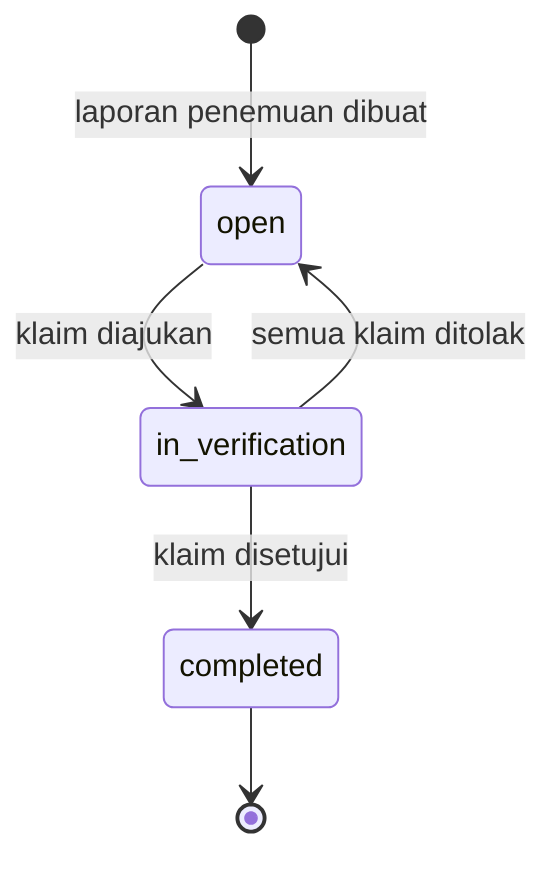

# Dokumentasi API LostFound

REST API backend aplikasi LostFound (Laravel + MySQL). Dokumen ini menjadi acuan saat membuat aplikasi Flutter di folder `mobile/` dan bahan untuk bagian perancangan sistem pada laporan.

> Contoh respons di dokumen ini disederhanakan. Nilai `id`, tanggal, dan token akan berbeda di setiap lingkungan.

## 1. Informasi umum

| Item | Nilai |
|---|---|
| Base URL (lokal) | `http://localhost:8000/api` |
| Base URL (emulator Android) | `http://10.0.2.2:8000/api` |
| Format data | JSON, kecuali endpoint upload foto yang memakai `multipart/form-data` |
| Autentikasi | Token Bearer (Laravel Sanctum) |

### Header

| Header | Keterangan |
|---|---|
| `Accept: application/json` | **Wajib** di semua request agar error selalu berbentuk JSON |
| `Authorization: Bearer <token>` | Wajib di semua endpoint, kecuali register dan login |
| `Content-Type: application/json` | Untuk request dengan body JSON. Request upload foto memakai `multipart/form-data` |

### Konvensi respons

- Respons dari endpoint laporan dan klaim **dibungkus** dalam kunci `data`. Respons autentikasi tidak dibungkus.
- Respons daftar yang berhalaman berisi `data`, `links`, dan `meta`. Satu halaman memuat 10 data. Pindah halaman dengan parameter `?page=2`.
- Nilai waktu `created_at` dan `verified_at` berformat ISO 8601 dalam **UTC**. Konversikan ke WIB (UTC+7) di aplikasi.
- `event_date` dan `event_time` adalah waktu kejadian apa adanya (tanpa zona waktu). `event_time` bisa berformat `HH:mm` pada respons pembuatan laporan dan `HH:mm:ss` pada respons lain, jadi ambil jam dan menitnya saja.
- `photo_url` dan `proof_photo_url` berupa URL lengkap yang memakai alamat server sesuai request, sehingga bisa dibuka dari emulator maupun perangkat.
- Perubahan laporan memakai method **POST** (bukan PUT/PATCH) karena PHP tidak membaca file upload pada request multipart PUT/PATCH.

### Format error

Kesalahan umum:

```json
{ "message": "Email atau password salah" }
```

Kesalahan validasi (422):

```json
{
  "message": "The email field is required.",
  "errors": {
    "email": ["The email field is required."]
  }
}
```

| Kode | Arti |
|---|---|
| 200 | Berhasil |
| 201 | Data berhasil dibuat |
| 401 | Token tidak ada, salah, atau sudah dicabut. Pada login: email atau password salah |
| 403 | Tidak punya hak akses |
| 404 | Data tidak ditemukan |
| 422 | Validasi gagal atau aturan alur dilanggar |
| 429 | Terlalu banyak percobaan login (maksimal 10 per menit) |

## 2. Ringkasan endpoint

| Metode | Endpoint | Fungsi | Akses |
|---|---|---|---|
| POST | `/register` | Mendaftar akun | Publik |
| POST | `/login` | Masuk dan mendapat token | Publik |
| GET | `/me` | Data pengguna yang login | Login |
| POST | `/logout` | Keluar (mencabut token) | Login |
| GET | `/categories` | Daftar kategori barang | Login |
| GET | `/locations` | Daftar lokasi | Login |
| GET | `/items` | Daftar laporan, dengan pencarian dan filter | Login |
| GET | `/items/{id}` | Detail laporan | Login |
| POST | `/items` | Membuat laporan kehilangan atau penemuan | Login |
| POST | `/items/{id}` | Mengubah laporan | Pemilik laporan atau admin |
| DELETE | `/items/{id}` | Menghapus laporan | Pemilik laporan atau admin |
| POST | `/items/{id}/claims` | Mengajukan klaim atas laporan penemuan | Login |
| GET | `/items/{id}/claims` | Daftar klaim pada sebuah laporan | Pemilik laporan atau admin |
| GET | `/claims/{id}` | Detail klaim | Pengaju klaim, pemilik laporan, atau admin |
| POST | `/claims/{id}/approve` | Menyetujui klaim | Pemilik laporan atau admin |
| POST | `/claims/{id}/reject` | Menolak klaim | Pemilik laporan atau admin |
| GET | `/my/items` | Riwayat laporan milik sendiri | Login |
| GET | `/my/claims` | Riwayat klaim milik sendiri | Login |

## 3. Autentikasi

### POST `/register`

Mendaftarkan akun baru. Role selalu `user` dan tidak bisa ditentukan dari request.

Body (JSON):

| Field | Wajib | Aturan |
|---|---|---|
| `name` | Ya | Teks, maksimal 255 karakter |
| `nim` | Tidak | Teks, maksimal 30 karakter, unik |
| `email` | Ya | Format email, unik |
| `phone` | Tidak | Teks, maksimal 20 karakter |
| `password` | Ya | Minimal 8 karakter |

Respons 201:

```json
{
  "message": "Registrasi berhasil",
  "user": {
    "id": 2,
    "name": "Budi",
    "nim": "24010001",
    "email": "budi@mail.com",
    "phone": "081234567890",
    "role": "user"
  },
  "token": "1|xxxxxxxxxxxxxxxx"
}
```

### POST `/login`

Body (JSON): `email` dan `password`, keduanya wajib.

Respons 200:

```json
{
  "message": "Login berhasil",
  "user": { "id": 2, "name": "Budi", "email": "budi@mail.com", "role": "user" },
  "token": "2|xxxxxxxxxxxxxxxx"
}
```

Respons 401: `{ "message": "Email atau password salah" }`

Simpan nilai `token` di aplikasi dan kirim sebagai `Authorization: Bearer <token>` pada setiap request berikutnya.

### GET `/me`

Respons 200:

```json
{ "user": { "id": 2, "name": "Budi", "email": "budi@mail.com", "role": "user" } }
```

### POST `/logout`

Mencabut token yang sedang dipakai. Perangkat lain yang punya token berbeda tidak ikut keluar.

Respons 200: `{ "message": "Logout berhasil" }`

## 4. Data master

### GET `/categories`

```json
{
  "data": [
    { "id": 5, "name": "Dokumen" },
    { "id": 1, "name": "Dompet" }
  ]
}
```

### GET `/locations`

```json
{
  "data": [
    { "id": 1, "name": "Perpustakaan", "description": null }
  ]
}
```

Gunakan `id` dari kedua endpoint ini untuk mengisi `category_id` dan `location_id`.

## 5. Laporan barang

### Objek laporan

```json
{
  "id": 12,
  "type": "found",
  "name": "Dompet hitam",
  "description": "Ditemukan di meja baca lantai 2",
  "photo_url": "http://localhost:8000/storage/items/abc123.jpg",
  "event_date": "2026-11-25",
  "event_time": "14:30:00",
  "status": "open",
  "category": { "id": 1, "name": "Dompet" },
  "location": { "id": 1, "name": "Perpustakaan" },
  "reporter": { "id": 3, "name": "Budi" },
  "created_at": "2026-11-26T03:15:00.000000Z"
}
```

- `type`: `lost` (kehilangan) atau `found` (penemuan).
- `status`: `open`, `in_verification`, atau `completed` (lihat bagian 8).
- `photo_url`: `null` jika laporan tidak memakai foto.
- `reporter` hanya memuat `id` dan `name`. Email dan nomor telepon pelapor tidak ditampilkan.
- `pending_claims_count` (jumlah klaim yang menunggu diperiksa) hanya muncul pada `/my/items`.

### GET `/items`

Daftar laporan, terbaru lebih dulu, 10 data per halaman.

| Parameter | Fungsi | Contoh |
|---|---|---|
| `type` | Jenis laporan | `lost` atau `found` |
| `search` | Cari pada nama dan deskripsi | `dompet` |
| `category_id` | Filter kategori | `1` |
| `location_id` | Filter lokasi | `1` |
| `date_from` | Tanggal kejadian mulai dari | `2026-11-01` |
| `date_to` | Tanggal kejadian sampai | `2026-11-30` (tidak boleh sebelum `date_from`) |
| `status` | Status laporan | `open`, `in_verification`, `completed` |
| `page` | Nomor halaman | `2` |

Semua parameter bersifat opsional dan bisa digabung. Contoh untuk dashboard:

- Barang hilang terbaru: `GET /items?type=lost&status=open`
- Barang ditemukan terbaru: `GET /items?type=found&status=open`
- Pencarian: `GET /items?search=dompet&category_id=1&location_id=1&date_from=2026-11-01`

Respons 200:

```json
{
  "data": [ { "id": 12, "type": "found", "name": "Dompet hitam" } ],
  "links": { "first": "...", "last": "...", "prev": null, "next": "..." },
  "meta": { "current_page": 1, "last_page": 3, "per_page": 10, "total": 25 }
}
```

(Isi tiap elemen `data` adalah objek laporan lengkap, dipersingkat di sini.)

### GET `/items/{id}`

Respons 200: `{ "data": { ...objek laporan } }`. Respons 404 jika id tidak ada.

### POST `/items`

Membuat laporan. Kirim sebagai `multipart/form-data`.

| Field | Wajib | Aturan |
|---|---|---|
| `type` | Ya | `lost` atau `found` |
| `name` | Ya | Teks, maksimal 255 karakter |
| `description` | Ya | Teks |
| `category_id` | Ya | `id` dari `/categories` |
| `location_id` | Ya | `id` dari `/locations` |
| `event_date` | Ya | Format `YYYY-MM-DD`, tidak boleh di masa depan |
| `event_time` | Tidak | Format `HH:mm` (24 jam) |
| `photo` | Tidak | File jpg, jpeg, png, atau webp, maksimal 5 MB |

Pelapor diambil dari token. Status laporan baru selalu `open`.

Respons 201: `{ "data": { ...objek laporan } }`

### POST `/items/{id}`

Mengubah laporan. Kirim sebagai `multipart/form-data`. Semua field bersifat opsional, tetapi yang dikirim harus valid.

| Field | Aturan |
|---|---|
| `name`, `description` | Sama seperti saat membuat laporan |
| `category_id`, `location_id` | Sama seperti saat membuat laporan |
| `event_date`, `event_time` | Sama seperti saat membuat laporan |
| `photo` | Jika dikirim, foto lama diganti dan file lamanya dihapus |

Jenis laporan (`type`) tidak bisa diubah.

Aturan akses:

- Hanya pemilik laporan atau admin (403 jika bukan).
- Hanya saat status masih `open` (422 jika laporan sedang diverifikasi atau sudah selesai).

Respons 200: `{ "data": { ...objek laporan } }`

### DELETE `/items/{id}`

Menghapus laporan beserta file fotonya. Aturan akses sama seperti mengubah laporan.

Respons 200: `{ "message": "Laporan berhasil dihapus" }`

## 6. Klaim dan verifikasi

### Aturan klaim

- Klaim hanya bisa diajukan pada laporan **penemuan** (`found`).
- Laporan harus berstatus `open` atau `in_verification`.
- Pengaju tidak boleh mengklaim laporannya sendiri.
- Satu pengguna hanya boleh punya satu klaim aktif (`pending` atau `approved`) pada satu laporan. Setelah klaimnya ditolak, ia boleh mengajukan lagi.
- Yang memverifikasi adalah pemilik laporan penemuan (yang memegang barang) atau admin. Tidak ada yang boleh memverifikasi klaimnya sendiri.

### Objek klaim

```json
{
  "id": 7,
  "status": "approved",
  "proof_description": "Di dalam dompet ada KTM atas nama saya dan foto keluarga",
  "proof_photo_url": null,
  "verifier_note": "Ciri-ciri sesuai",
  "verified_at": "2026-11-26T05:00:00.000000Z",
  "created_at": "2026-11-26T04:10:00.000000Z",
  "item": { "id": 12, "name": "Dompet hitam", "status": "completed" },
  "claimant": { "id": 5, "name": "Sari" },
  "contact": { "name": "Budi", "phone": "081234567890" }
}
```

- `status`: `pending`, `approved`, atau `rejected`.
- `item` berisi objek laporan lengkap (dipersingkat di contoh).
- `contact` **hanya muncul jika klaim berstatus `approved`**. Isinya data pihak lawan: pengaju klaim melihat kontak pemilik laporan, dan pemilik laporan melihat kontak pengaju. Nomor telepon bernilai `null` jika pengguna tidak mengisinya saat mendaftar.

### POST `/items/{id}/claims`

Mengajukan klaim. Kirim sebagai `multipart/form-data`.

| Field | Wajib | Aturan |
|---|---|---|
| `proof_description` | Ya | Teks, minimal 10 karakter. Jelaskan ciri atau isi barang yang hanya diketahui pemiliknya |
| `proof_photo` | Tidak | File jpg, jpeg, png, atau webp, maksimal 5 MB |

Efek: klaim dibuat dengan status `pending` dan status laporan berubah menjadi `in_verification`.

Respons 201: `{ "data": { ...objek klaim } }`

Respons 422 (contoh pesan): `Klaim hanya bisa diajukan pada laporan penemuan`, `Barang ini sudah tidak bisa diklaim`, `Anda tidak bisa mengklaim laporan milik sendiri`, `Anda sudah mengajukan klaim untuk barang ini`.

### GET `/items/{id}/claims`

Daftar semua klaim pada sebuah laporan, terbaru lebih dulu. Hanya untuk pemilik laporan atau admin (403 jika bukan).

Respons 200: `{ "data": [ { ...objek klaim } ] }`

### GET `/claims/{id}`

Detail satu klaim. Hanya untuk pengaju klaim, pemilik laporan, atau admin (403 jika bukan).

Respons 200: `{ "data": { ...objek klaim } }`

### POST `/claims/{id}/approve`

Menyetujui klaim.

Body (JSON): `verifier_note` (opsional, maksimal 500 karakter).

Efek:

1. Klaim menjadi `approved`.
2. Klaim lain pada laporan yang sama yang masih `pending` otomatis menjadi `rejected`.
3. Status laporan menjadi `completed`.

Respons 200: `{ "data": { ...objek klaim } }` (dengan `contact`).

### POST `/claims/{id}/reject`

Menolak klaim.

Body (JSON): `verifier_note` (**wajib**, maksimal 500 karakter) berisi alasan penolakan.

Efek: klaim menjadi `rejected`. Jika tidak ada klaim `pending` lain, status laporan kembali menjadi `open`.

Respons 200: `{ "data": { ...objek klaim } }`

Untuk approve dan reject:

- 403 jika bukan pemilik laporan atau admin, atau jika mencoba memverifikasi klaim sendiri.
- 422 jika klaim sudah diproses (`Klaim ini sudah diproses`).

## 7. Riwayat

### GET `/my/items`

Riwayat laporan milik pengguna yang login, terbaru lebih dulu, 10 data per halaman. Setiap laporan memuat `pending_claims_count`, yaitu jumlah klaim yang menunggu diperiksa.

Respons 200: `{ "data": [ ... ], "links": { ... }, "meta": { ... } }`

### GET `/my/claims`

Riwayat klaim yang pernah diajukan pengguna yang login, terbaru lebih dulu, 10 data per halaman. Gunakan field `status` untuk menampilkan proses klaim, dan `verifier_note` untuk alasan penolakan.

Respons 200: `{ "data": [ ... ], "links": { ... }, "meta": { ... } }`

## 8. Alur status

Status laporan:



| Kejadian | Status klaim | Status laporan |
|---|---|---|
| Laporan penemuan dibuat | - | `open` |
| Ada yang mengajukan klaim | `pending` | `in_verification` |
| Klaim ditolak dan tidak ada klaim `pending` lain | `rejected` | `open` |
| Klaim disetujui | `approved` (klaim `pending` lain menjadi `rejected`) | `completed` |

Laporan kehilangan (`lost`) tidak diklaim. Statusnya tetap `open` sampai pemiliknya menghapusnya.

## 9. Catatan untuk aplikasi Flutter

- Kirim `Accept: application/json` di semua request.
- Simpan token setelah register atau login, dan sertakan di header `Authorization`. Jika menerima 401 pada endpoint selain login, arahkan pengguna ke halaman login.
- Untuk membuat atau mengubah laporan dan klaim yang memuat foto, gunakan request **multipart**. Kompres foto sebelum diunggah karena batas server 5 MB.
- Ubah laporan dengan POST ke `/items/{id}`, bukan PUT.
- Pada emulator Android, gunakan `http://10.0.2.2:8000/api`. Pada perangkat fisik, gunakan alamat IP laptop di jaringan yang sama dan jalankan server dengan `php artisan serve --host=0.0.0.0`.
- Konversikan `created_at` dan `verified_at` dari UTC ke WIB sebelum ditampilkan.

## 10. Keterbatasan yang diketahui

- Foto bukti klaim disimpan di penyimpanan publik, sehingga siapa pun yang mengetahui URL-nya dapat membukanya. Versi produksi sebaiknya menyimpannya di penyimpanan privat dan menyajikannya lewat endpoint yang memeriksa hak akses.
- Token tidak memiliki masa berlaku dan baru tidak berlaku setelah logout.
- Belum ada notifikasi. Perubahan status klaim dilihat dengan membuka ulang halaman terkait.
